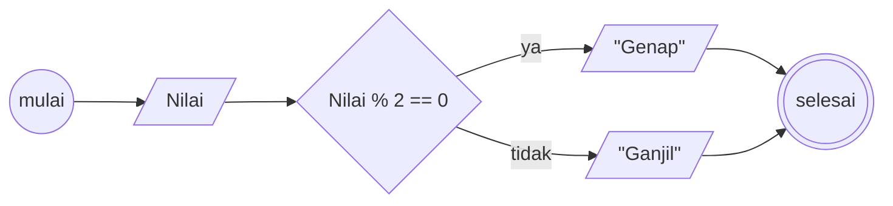
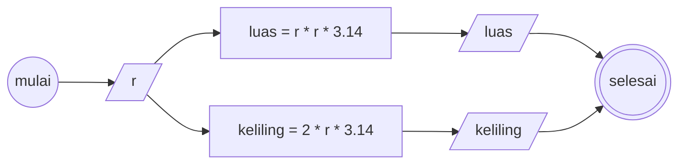

# Algoritma
## memindahkan Air
1. mulai
2. siapkan 1 gelas kosong (gelas C)
3. pindahkan isi gelas teh ke dalam gelas kosong (gelas C)
4. pindahkan isi gelas kopi ke dalam gelas bekas teh (gelas A)
5. pindahkan isi gelas teh ke dalam gelas bekas kopi (gelas B)
6. selesai

## menentukan bilangan ganjil atau genap
1. mulai
2. tentukan atau pilih nilai yang akan dicari tau genap atau ganjil
3. terapkan operasi matematika modulo dengan angka 2, ke nilai awal yang sudah dipilih, yang akan memberikan sisa pembagian
4. jika sisa pembagian 1, maka angka yang dipilih diawal adalah ganjil
5. jika sisa pembagian 0, maka angka yang dipilih diawal adalah genap
6. selesai

### flowchart

## menghitung luas dan keliling lingkaran
1. mulai
2. tentukan nilai jari - jari lingkaran (r)
3. untuk menghitung luas lingkaran, maka nilai jari - jari yang dikuadratkan (r * r) di kalikan nilai pi (pi * r * r), dimana nilai pi bisa di approksimasikan sebagai 3.14
4. untuk menghitung keliling, maka nilai jari - jari dikali dengan 2 kali pi (2 * pi * r)
5. selesai

### flowchart

